# Tavoryn Terminal

> *Research with rigor. Risk with discipline. Execution with control.*

[](https://nodejs.org/)
[](LICENSE)
[](package.json)
[](test/)
[](docs/release/)

**Tavoryn Terminal** is an institutional-grade, local financial market research station and Bloomberg-style quantitative workspace engineered to run entirely on your local machine. Built with high-contrast amber CRT aesthetics, tabular numerals, and dedicated financial function keys, Tavoryn delivers real-time global market surveillance, fundamental company filings, multi-asset technical charting, intrinsic DCF valuation models, portfolio stress testing, event-driven backtesting, options chains, sovereign yield curves, and pre-trade risk-controlled paper trading.

Every market quote, economic metric, and financial filing is sourced from public market feeds without requiring accounts or paid API keys. Tavoryn is completely self-contained with **zero runtime npm dependencies** (`"dependencies": {}`) and adheres strictly to an **offline-first, capital-safe execution model**. All paper trading activities are isolated inside a protected local simulation ledger.

---

## Architecture Overview

```text
                               ┌───────────────────────────────────────────────┐
                               │           Tavoryn Desktop Workspace           │
                               │  Header Chrome · Clocks · Global Command Bar  │
                               └──────────────────────┬────────────────────────┘
                                                      │
                       ┌──────────────────────────────┴──────────────────────────────┐
                       ▼                                                             ▼
       ┌───────────────────────────────┐                             ┌───────────────────────────────┐
       │   4-Panel CRT Workspace (/)   │                             │    In-App User Manual (/help) │
       │  Panel 1   │     Panel 2      │ ◄─── Two-Way SPA Routing ──►│  Table of Contents (16 Mods) │
       │  ──────────┼──────────────────│                             │  Full-Text Search Engine      │
       │  Panel 3   │     Panel 4      │                             │  Formulas & Operating Runbook │
       └───────────────┬───────────────┘                             └───────────────────────────────┘
                       │
                       ▼
┌─────────────────────────────────────────────────────────────────────────────────────────────────────┐
│                             Local Node.js Financial Server (server.js)                             │
├───────────────────────┬─────────────────────────────┬────────────────────────┬──────────────────────┤
│  Market Data Providers│   Quantitative Analytics    │    Paper Ledger Core   │   Data Export & API  │
│  - Binance / Coinbase │   - DCF Valuation Engine    │   - data/paper-account │   - /api/bdh (Hist)  │
│  - Nasdaq / Yahoo     │   - Portfolio Stress Models │   - Pre-Trade Gateway  │   - /api/bdp (Snap)  │
│  - SEC EDGAR / CBOE   │   - Strategy Backtester     │   - Zero Live Routing  │   - CSV Exporter     │
│  - US Treasury / St.L │   - Options Pricing (BSM)   │   - 16 Risk Gateways   │   - REST Endpoints   │
└───────────────────────┴─────────────────────────────┴────────────────────────┴──────────────────────┘
```

---

## Quickstart & Installation

### Prerequisites
- **Node.js 18.0.0 or higher** (Node.js 20+ or 22+ recommended).
- **No external installation commands required:** There is no `npm install` step. Zero third-party runtime npm packages are installed.

### Launching the Terminal

```bash
# 1. Run local environment verification and pre-flight checks
npm run check

# 2. Launch Tavoryn Terminal in the background and open browser
npm start
```

Alternatively, launch directly with Node.js:
```bash
node server.js
```

Then open your browser to **`http://localhost:3787/`** (or access the In-App User Manual directly at **`http://localhost:3787/user-manual`**).

To run the offline test suite (612 tests across 41 test files):
```bash
npm test
```

---

## Core Features & Screenshot Walkthrough

### 1. 4-Panel Bloomberg-Style CRT Workspace
The primary terminal layout displays four independent, reactive analytical panels simultaneously. Each panel maintains its own command prompt, execution history, and active security context, while the top global bar allows instant command routing to any active panel.

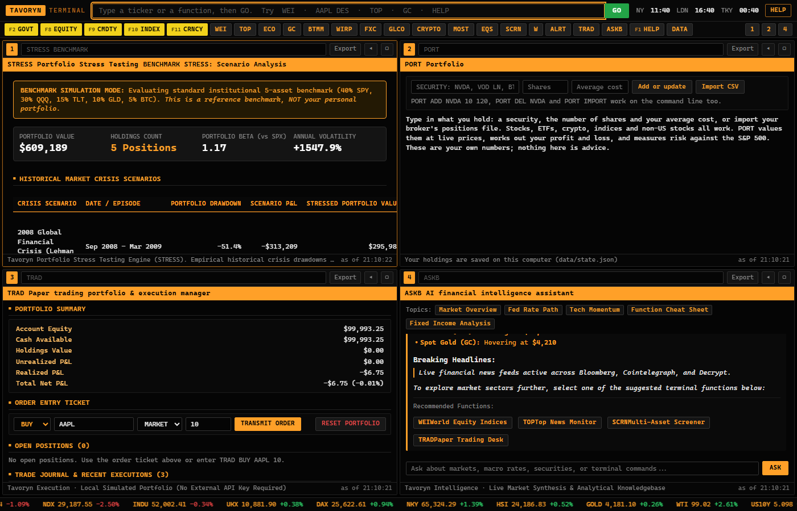

- **Layout Flexibility:** Toggle dynamically between 1, 2, and 4 panels via `LAYOUT 1`, `LAYOUT 2`, or `LAYOUT 4`.
- **Keyboard Navigation:** Switch active panels instantly using <kbd>Ctrl</kbd> + <kbd>1</kbd> .. <kbd>4</kbd> (or <kbd>Cmd</kbd> + <kbd>1</kbd> .. <kbd>4</kbd>).
- **Global Input Jump:** Press <kbd>/</kbd> from anywhere in the terminal to jump cursor focus directly into the global command line.

---

### 2. Global Market Surveillance (`WEI`, `GLCO`, `FXC`, `CRYPTO`, `MOST`)
Cross-asset real-time market surveillance covering global equities, sovereign debt, foreign exchange, energy, precious metals, agriculture, and digital assets.

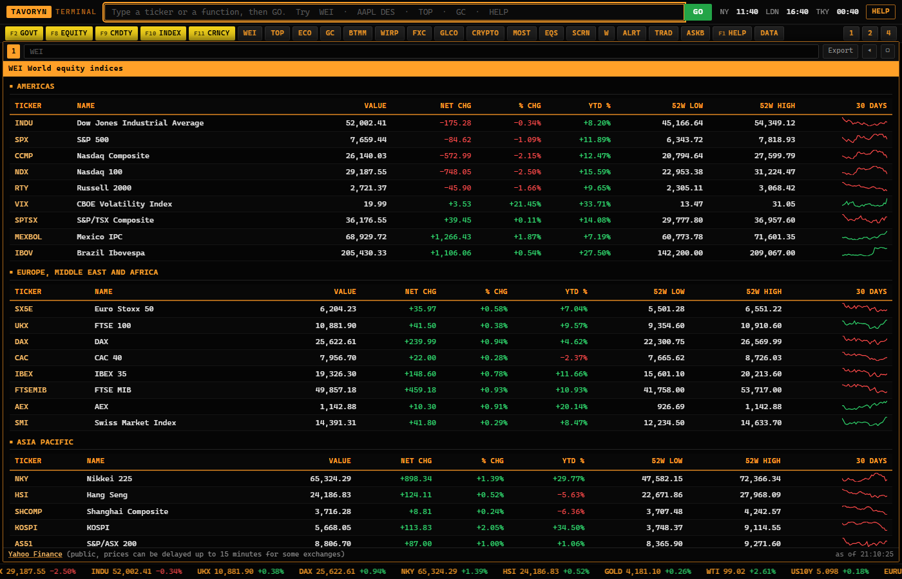

- **`WEI` (World Equity Indices):** Americas (S&P 500, Nasdaq, Dow Jones, Russell 2000, TSX), EMEA (FTSE 100, DAX, CAC 40, IBEX, Euro Stoxx 50), and APAC (Nikkei 225, Hang Seng, Shanghai Composite, ASX 200).
- **`GLCO` (Global Commodities):** Front-month futures for WTI Crude Oil, Brent Crude, Natural Gas, Gold, Silver, Copper, Platinum, Corn, Wheat, and Soybeans.
- **`FXC` (Foreign Exchange):** G10 currency cross-rate matrix and real-time spot FX pairs (EUR/USD, USD/JPY, GBP/USD, USD/CHF, AUD/USD, USD/CAD).
- **`CRYPTO` (Digital Assets):** Streaming price discovery and 24-hour volume for BTC, ETH, SOL, XRP, ADA, and DOGE.
- **`MOST` (Active Movers):** Top percentage gainers, decliners, and volume leaders across US equity exchanges.

---

### 3. Interactive Technical Charting & 87 Indicators (`GP`, `GIP`, `HP`, `COMP`)
High-performance financial charts powered by TradingView Lightweight Charts™ featuring candlestick, bar, line, mountain, and baseline rendering with synchronized volume histograms.

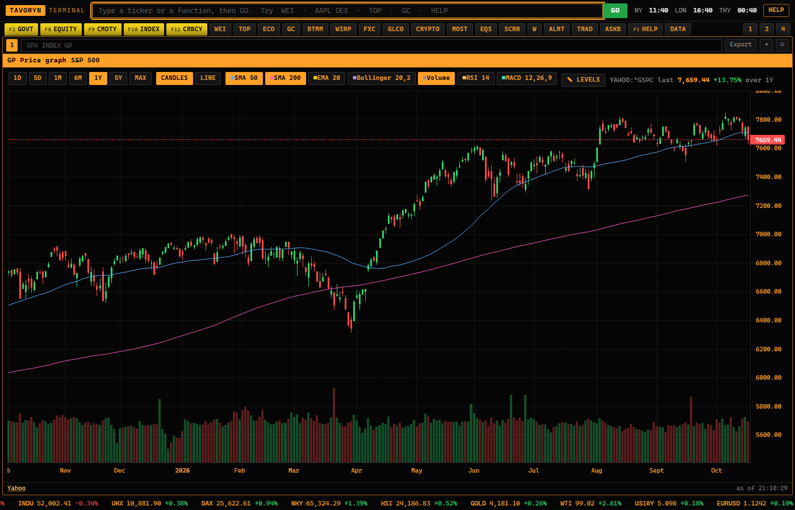

- **Timeframe Granularity:** Multi-timeframe analysis spanning 1-minute (`1M`), 5-minute (`5M`), 15-minute (`15M`), 1-hour (`1H`), daily (`1D`), and weekly (`1W`) bars.
- **87 Verified Technical Studies:** Built-in quantitative indicators verified against TradingView reference implementations:
  - *Trend:* SMA, EMA, WMA, HMA, VWMA, DEMA, TEMA, SuperTrend, Parabolic SAR, Ichimoku Cloud, Aroon, ADX.
  - *Momentum:* RSI, MACD, Stochastic Oscillator, Stochastic RSI, CCI, Williams %R, Rate of Change (ROC), TSI.
  - *Volatility:* Bollinger Bands, Keltner Channels, Donchian Channels, Average True Range (ATR), Historical Volatility.
  - *Volume:* On-Balance Volume (OBV), Chaikin Money Flow (CMF), Accumulation/Distribution (A/D), Volume Weighted Average Price (VWAP), Anchored VWAP.

---

### 4. Quantitative DCF Valuation & Sensitivity Matrix (`DCF`)
Institutional Discounted Cash Flow valuation engine projecting 5-year Free Cash Flow to Firm (FCFF), discounting at the Weighted Average Cost of Capital (WACC), and computing intrinsic equity value per share.

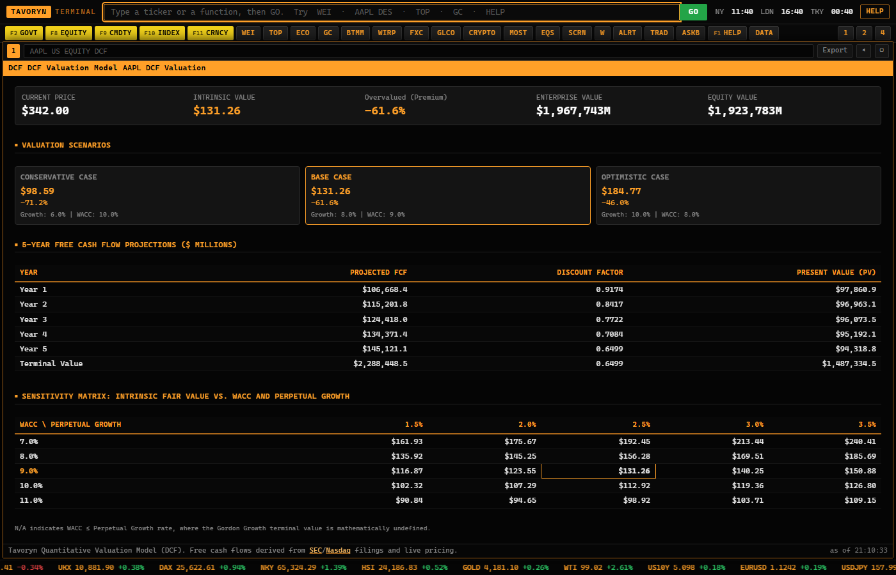

- **Mathematical Formulations:**
  $$\text{FCFF} = \text{EBIT} \times (1 - t) + \text{D\&A} - \text{CapEx} - \Delta\text{NWC}$$
  $$\text{Enterprise Value} = \sum_{t=1}^{5} \frac{\text{FCFF}_t}{(1 + \text{WACC})^t} + \frac{\text{Terminal Value}}{(1 + \text{WACC})^5}$$
  $$\text{Terminal Value (Gordon Growth)} = \frac{\text{FCFF}_5 \times (1 + g)}{\text{WACC} - g}$$
  $$\text{Equity Value} = \text{Enterprise Value} + \text{Cash} - \text{Total Debt}$$
- **Interactive Sensitivity Table:** Dynamic two-dimensional matrix evaluating intrinsic share price across varying WACC ($7.0\%$ to $11.0\%$) and perpetual growth rates ($1.5\%$ to $3.5\%$).
- **Strict Boundary Safety:** Automatic mathematical validation requiring $\text{WACC} > g$. When $\text{WACC} \le g$, the engine surfaces clear boundary warnings rather than computing non-economic or infinite valuations.

---

### 5. Portfolio Stress Testing & Crisis Scenarios (`STRESS`)
Quantitative stress testing engine evaluating multi-asset portfolio drawdowns and factor vulnerabilities across historical crisis episodes and macroeconomic shocks.

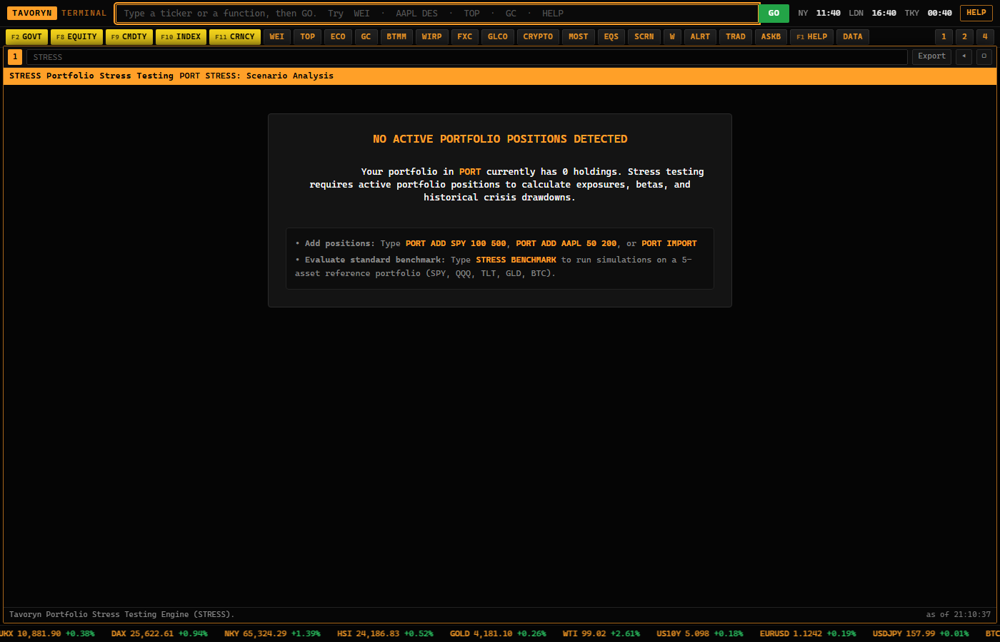

- **Historical Crisis Episodes:**
  - *2008 Global Financial Crisis (Lehman Collapse):* $-51.4\%$ equity shock, $+18.2\%$ Treasury rally, $-42.0\%$ commodity shock.
  - *2020 COVID Market Crash:* $-33.9\%$ equity shock, $+8.5\%$ Treasury flight-to-safety, $-54.0\%$ energy shock.
  - *2022 Rapid Fed Rate Hike Shock:* $-25.4\%$ equity drawdown, $-29.3\%$ long-duration Treasury drawdown.
  - *2000 Dot-Com Tech Bubble Burst:* $-78.0\%$ tech sector drawdown, flight to defensives.
  - *1987 Black Monday:* $-22.6\%$ single-day equity shock.
  - *1973 Oil Embargo & Stagflation:* $+300\%$ energy shock, $-40\%$ equity real decline.
  - *2011 US Sovereign Debt Downgrade:* High-volatility risk-off dislocation.
  - *2015 China Yuan Devaluation & Commodity Slump:* Global emerging markets contagion.
- **Macroeconomic Factor Shocks:** Evaluates isolated sensitivity to $+200\,\text{bps}$ Interest Rate Shock, $+25\%\,\text{USD}$ Currency Surge, $-40\%\,\text{Crude Oil}$ Energy Deflation, and $+15\,\text{points}$ VIX Volatility Spike.
- **Holdings Vulnerability Ranking:** Ranks every open position from highest to lowest projected dollar loss to pinpoint single-name risk concentrations.

---

### 6. Event-Driven Strategy Backtesting (`BTST`)
Local quantitative backtest replay engine simulating strategy performance over multi-year historical price series with automated performance attribution and trade logging.

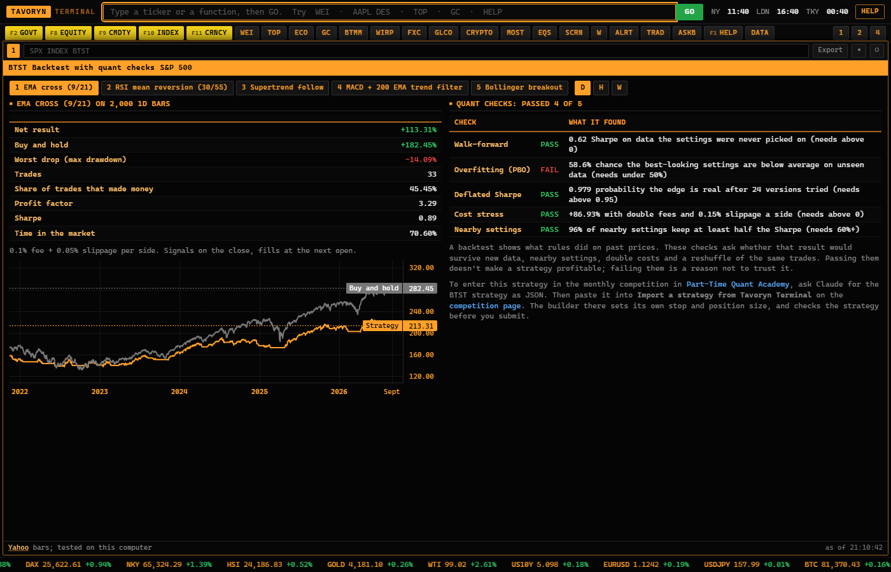

- **Built-in Strategy Library:**
  - *SMA Crossover:* Fast and slow moving average trend following (e.g., 50-day / 200-day Golden Cross).
  - *RSI Mean Reversion:* Long oversold ($\text{RSI} < 30$), exit overbought ($\text{RSI} > 70$).
  - *Bollinger Breakout:* Volatility expansion breakout above upper envelope.
  - *MACD Signal Divergence:* Moving average convergence divergence histogram confirmation.
  - *Turtle Breakout:* 20-day high entry / 10-day low exit channel rules.
- **Rigorous Quantitative Metrics:** Calculates Compounded Annual Growth Rate (CAGR), Maximum Drawdown (MDD), Sharpe Ratio, Sortino Ratio, Win Rate %, Profit Factor, and trade distribution.

---

### 7. Real-Time Options Chains & Volatility Surface (`OMON`, `OVDV`, `OPAY`)
Comprehensive options chain monitoring with implied volatility calculations, options greeks, and multi-leg spread payoff profiles.

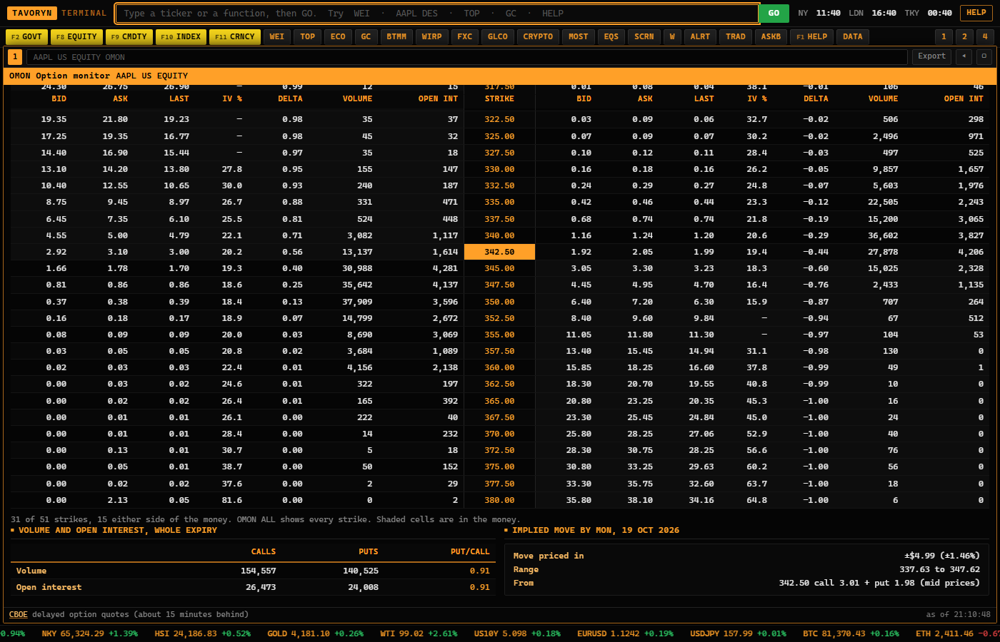

- **Full Expiry Strip:** Filter across near-term weekly and standard monthly expiration cycles.
- **Analytical Pricing:** Computes Black-Scholes implied volatility (IV), Delta ($\Delta$), Gamma ($\Gamma$), Theta ($\Theta$), and Vega ($\nu$) for every call and put strike.
- **Market Dynamics:** Live tracking of aggregate open interest, volume, put/call volume ratios, and the market-implied earnings move.
- **Payoff Profiler (`OPAY`):** Graphical profit/loss projection at expiration for single calls/puts, covered calls, straddles, strangles, and vertical bull/bear debit and credit spreads.

---

### 8. SEC Filings, Insiders & Ownership (`CF`, `INSD`, `HDS`, `DS`)
Direct integration with the US Securities and Exchange Commission (SEC) EDGAR system providing real-time regulatory filings and corporate transparency.

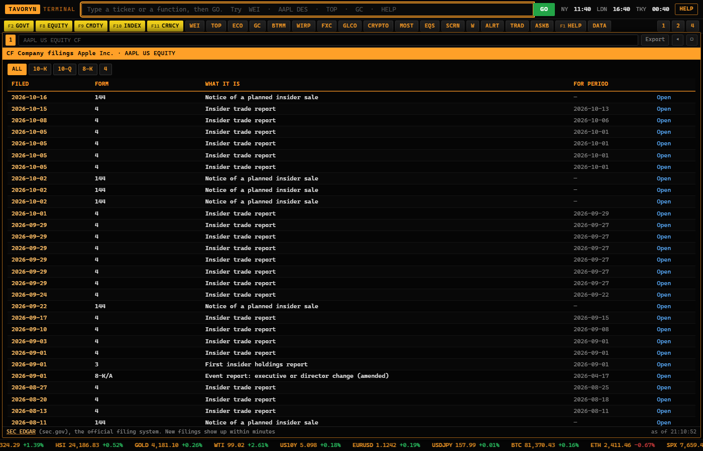

- **`CF` (Corporate Filings):** Live document links to Form 10-K (Annual Reports), 10-Q (Quarterly Reports), 8-K (Material Events), and S-1 Registration Statements.
- **`INSD` (Insider Transactions):** Real-time Form 4 insider transaction ledger detailing corporate officer purchases, sales, exercise prices, and net share change.
- **`HDS` (Institutional Ownership):** Form 13F institutional ownership breakdowns detailing top hedge fund, asset manager, and mutual fund position concentrations.
- **`DS` (Document Search):** Keyword search across filing text to research corporate risk disclosures, revenue guidance, and litigation reserves.

---

### 9. Macroeconomic Calendar & Economic Statistics (`ECO`, `SURP`, `ECST`, `COT`)
Macroeconomic surveillance tracking global central bank indicators, treasury issuance, and speculative market positioning.

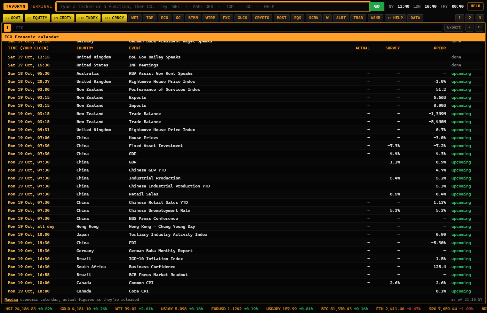

- **`ECO` (Economic Calendar):** Comprehensive schedule of upcoming macroeconomic announcements (US Nonfarm Payrolls, CPI, PPI, Real GDP, FOMC Rate Decisions, Retail Sales, ISM Manufacturing).
- **`SURP` (Economic Surprises):** Actual vs. consensus forecast dispersion highlighting macroeconomic beat/miss magnitude.
- **`ECST` (Economic Statistics):** Historical trend series covering unemployment, core inflation, debt-to-GDP ratios, and trade balances.
- **`COT` (Commitments of Traders):** CFTC weekly positioning data distinguishing commercial hedger vs. non-commercial speculative positioning across futures markets.

---

### 10. Sovereign Yield Curves & Rates (`GC`, `BTMM`, `WIRP`, `CBRT`, `CRED`, `AUCT`)
Fixed income and money market workstation analyzing sovereign debt yields, money market rates, and policy rate expectations.

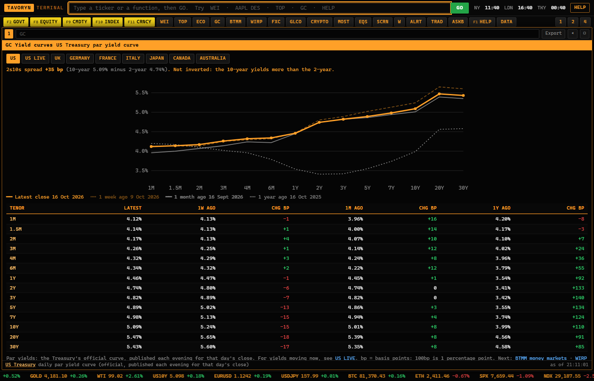

- **`GC` (Government Curve):** US Treasury sovereign yield curve spanning 1-month to 30-year tenors, featuring automatic 2s10s and 3M10Y yield curve inversion detection.
- **`BTMM` (Treasury Money Markets):** Short-term benchmark rates, Treasury bills, and overnight financing benchmarks.
- **`WIRP` (World Interest Rate Probabilities):** Fed Funds futures-implied probabilities of interest rate hikes and cuts across upcoming FOMC meetings.
- **`CBRT` (Central Bank Policy Rates):** Benchmark policy rates across global central banks (Federal Reserve, ECB, Bank of England, Bank of Japan, SNB, PBoC, RBA, Bank of Canada).
- **`CRED` (Credit Spreads):** High-yield and investment-grade corporate credit spread monitoring over benchmark sovereign curves.

---

### 11. Paper Trading & Pre-Trade Risk Gateway (`TRAD`, `OM`)
Simulated institutional trading platform executing multi-asset paper orders with real-time portfolio valuation and automated pre-trade risk controls.

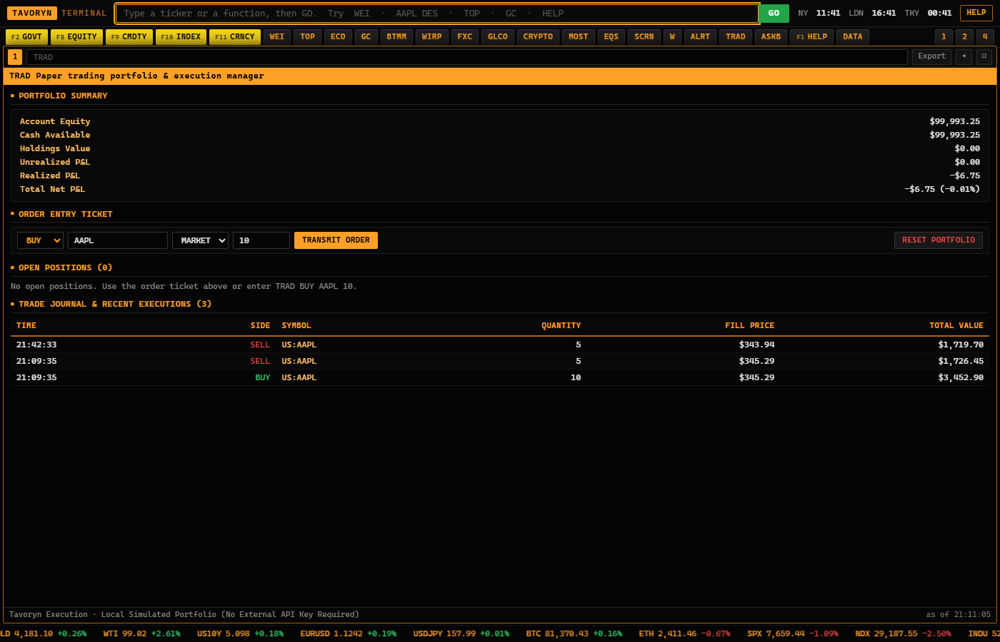

- **Capital-Safe Execution Model:** Strictly isolated from live broker APIs. All transactions execute in simulated local paper mode stored in `data/paper-account.json`.
- **Pre-Trade Risk Gateway (16 Checks):** Every order is evaluated against quantitative risk boundaries before execution:
  - Cash and purchasing power sufficiency.
  - Position concentration limits (maximum $25\%$ of total portfolio equity in a single asset).
  - Maximum order quantity and notional value caps.
  - Stale quote detection and sanity checks on bid/ask spread widths.
  - Duplicate order prevention.
- **Order Types:** Market orders, limit orders, and stop-loss orders with complete execution audit trail.

---

### 12. Portfolio Accounting & Analytics (`PORT`)
Complete portfolio management and mark-to-market performance accounting system.

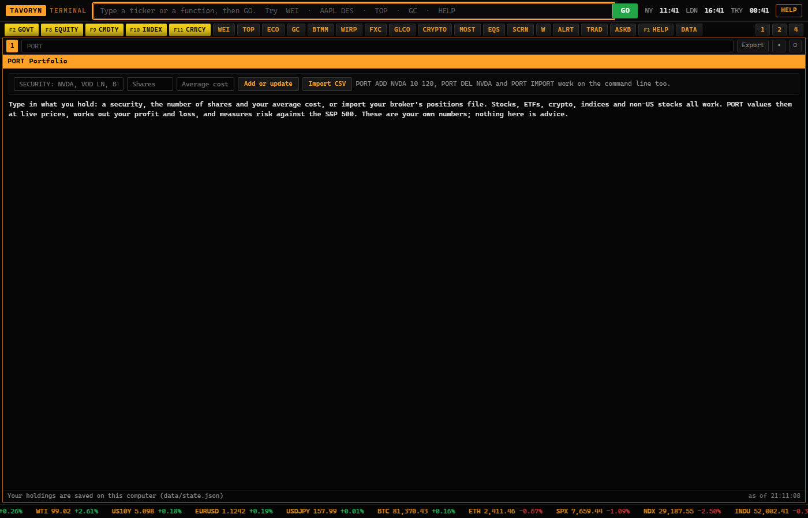

- **Real-Time Valuation:** Live mark-to-market portfolio equity, cash balance, unrealized P&L, realized P&L, and day change.
- **Risk Metrics:** Portfolio Beta ($\beta$) relative to the S&P 500, annualized volatility ($\sigma$), and position weight allocation.
- **Import/Export:** Direct CSV portfolio import for external positions and one-click export for reporting.

---

### 13. Financial Statements & Ratio Analysis (`FA`, `BQ`, `DES`, `DVD`, `EE`, `ANR`)
Deep fundamental equity research workstation extracting multi-year financial statements and valuation ratios.

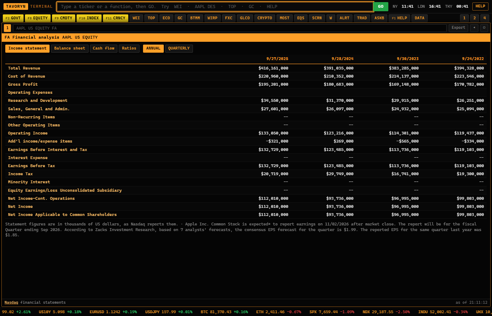

- **`FA` (Financial Statements):** 4-year and 4-quarter comparative Income Statement, Balance Sheet, and Cash Flow Statement.
- **`DES` (Company Description):** Executive overview, capital structure, enterprise value, sector/industry classification, and 52-week price range.
- **`BQ` (Bloomberg Quote):** Real-time quote snapshot with pre-market, regular hours, and post-market trading prices.
- **`DVD` (Dividends):** Historical dividend payments, ex-dividend dates, frequency, and payout ratios.
- **`ANR` (Analyst Recommendations):** Consensus Wall Street analyst targets, buy/hold/sell distribution, and consensus price target.

---

### 14. Stock & ETF Screener (`SCRN`, `EQS`)
Multi-metric equity screening engine filtering global investment universes by fundamental and technical criteria.

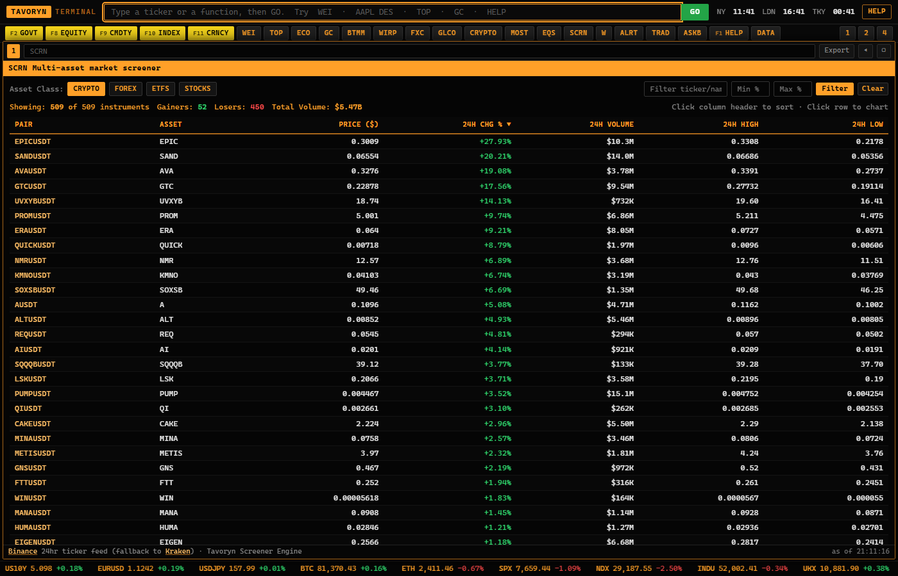

- **Fundamental Filters:** Market capitalization, P/E ratio, Price-to-Book (P/B), Dividend Yield %, ROE, and Debt-to-Equity.
- **Technical Filters:** 20-day / 50-day / 200-day moving average positioning, RSI overbought/oversold levels, and daily percentage change.
- **One-Click Export:** Instantly export filtered screener results to Excel-compatible CSV.

---

### 15. AI Market Intelligence (`ASK`, `ASKB`)
In-terminal financial intelligence assistant synthesizing macroeconomic events, regulatory filings, and market context.

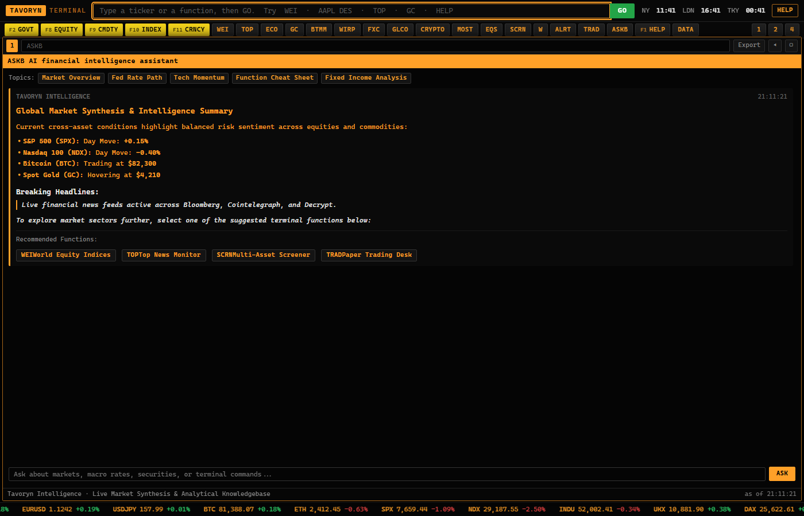

- **Natural Language Research:** Ask targeted market questions, e.g.:
  - *"What is the market pricing for the next two Federal Reserve FOMC meetings?"*
  - *"Compare 2-year and 10-year Treasury yields over the past six months."*
  - *"Which S&P 500 companies have significant insider buying reported on Form 4 this week?"*
- **Structured Context Citations:** Synthesizes terminal numbers with verifiable citations to underlying public feeds.

---

### 16. In-App Interactive User Manual & Help Center (`HELP`, `F1`, `/user-manual`)
A full-screen interactive manual and reference encyclopedia built directly into the terminal shell.

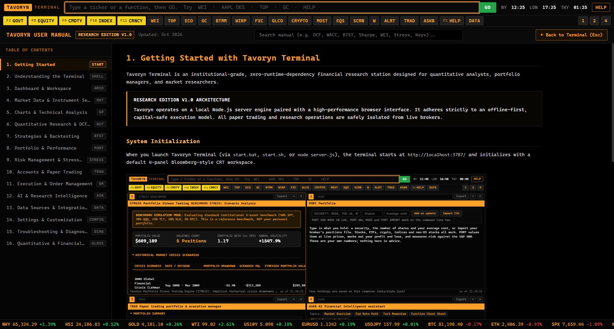

- **16 Modular Documentation Sections:** Complete operational runbooks covering system initialization, command syntax, quantitative formulas, trading rules, and troubleshooting.
- **Sub-Millisecond Search:** Instant client-side full-text search indexing across functions, inputs, formulas, metric definitions, and error codes.
- **Interactive Code Pills:** Clickable command badges (e.g., <span style="color:#ffa028">`AAPL US EQUITY DCF`</span>) that instantly load and run in the terminal workspace.
- **Responsive Navigation:** Smooth transition between terminal grid and documentation with keyboard shortcuts (<kbd>F1</kbd> to open, <kbd>Esc</kbd> to return).

---

## Function Code Directory (53 Functions)

| Code | Function Name | Scope | Inputs | Description |
|:---|:---|:---|:---|:---|
| **`WEI`** | World Equity Indices | Market | None | Global benchmark index levels, daily changes, YTD returns |
| **`GLCO`** | Global Commodities | Market | None | Energy, precious metals, industrial metals, agriculture |
| **`FXC`** | Foreign Exchange Matrix | Market | None | G10 cross rates and spot FX currency pairs |
| **`CRYPTO`** | Digital Asset Monitor | Market | None | Real-time streaming quotes for BTC, ETH, SOL, XRP, DOGE |
| **`MOST`** | Most Active / Movers | Market | None | Top gainers, losers, and volume leaders |
| **`TOP`** | Top Global News | Market | Category | Major financial headlines and market commentary |
| **`CN`** | Company News | Security | Ticker | Curated company-specific news headline stream |
| **`DES`** | Security Description | Security | Ticker | Business overview, market cap, P/E, 52W range, dividend |
| **`BQ`** | Bloomberg Quote | Security | Ticker | Real-time bid, ask, size, last, volume, pre/post market |
| **`FA`** | Financial Analysis | Security | Ticker | Income statement, balance sheet, cash flows, key ratios |
| **`CF`** | Corporate Filings | Security | Ticker | SEC EDGAR 10-K, 10-Q, 8-K filings with direct text links |
| **`INSD`** | Insider Transactions | Security | Ticker | SEC Form 4 insider purchases and sales by executives |
| **`HDS`** | Institutional Holdings | Security | Ticker | SEC Form 13F institutional ownership and top funds |
| **`DS`** | Document Search | Security | Query | Text search across corporate annual and quarterly filings |
| **`ERN`** | Earnings History | Security | Ticker | Historical reported EPS vs consensus estimates and surprise % |
| **`EE`** | Earnings Estimates | Security | Ticker | Consensus forward EPS and revenue analyst forecasts |
| **`ANR`** | Analyst Recommendations| Security | Ticker | Wall Street consensus price targets and buy/hold/sell |
| **`DVD`** | Dividend History | Security | Ticker | Dividend payout history, ex-dividend dates, yield |
| **`DCF`** | Discounted Cash Flow | Security | Ticker, WACC, $g$ | 5-year FCFF intrinsic valuation and sensitivity matrix |
| **`OMON`** | Option Monitor | Security | Ticker, Expiry | Full options chain with strikes, IV, volume, open interest |
| **`OVDV`** | Volatility Surface | Security | Ticker | Implied volatility term structure and strike skew |
| **`OPAY`** | Options Payoff Profile | Options | Strategy | Profit/Loss expiration diagrams for multi-leg option spreads |
| **`GP`** | Graphical Price Chart | Security | Ticker, Period | Interactive candlestick chart with volume and 87 indicators |
| **`GIP`** | Intraday Price Chart | Security | Ticker, Bar | 1-minute to 5-minute high-resolution intraday bars |
| **`HP`** | Historical Price Table | Security | Ticker, Range | Tabular daily OHLCV prices with percentage change |
| **`COMP`** | Comparative Returns | Security | Tickers | Normalized percentage performance comparison overlay |
| **`DRAW`** | Chart Annotations | Security | Ticker | Trendline and drawing tools on price charts |
| **`ECO`** | Economic Calendar | Market | Date/Region | Global economic releases (CPI, Nonfarm Payrolls, GDP, PMI) |
| **`SURP`** | Economic Surprises | Market | None | Actual vs consensus economic release deviations |
| **`ECST`** | Economic Statistics | Market | Country | Macroeconomic trend series from the Federal Reserve |
| **`COT`** | Commitments of Traders | Commodity| Market | CFTC commercial hedger vs speculative futures positioning |
| **`GC`** | Government Curve | Sovereign| Country | Sovereign yield curve (1M to 30Y) with 2s10s spread |
| **`BTMM`** | Treasury Money Markets | Sovereign| None | US Treasury bill yields, commercial paper, repo rates |
| **`WIRP`** | World Interest Rate Probs| Sovereign| Meeting | FOMC rate hike/cut probabilities priced by fed funds futures|
| **`CBRT`** | Central Bank Policy Rates| Sovereign| None | Benchmark policy rates across Fed, ECB, BoE, BoJ, SNB |
| **`CRED`** | Corporate Credit Spreads| Fixed Inc| Sector | High-yield and investment grade spreads over Treasuries |
| **`AUCT`** | Treasury Auctions | Sovereign| None | US Treasury auction results, bid-to-cover, allotment |
| **`BNDC`** | Bond Calculator | Fixed Inc| Yield, Coupon | Clean price, dirty price, duration, and convexity |
| **`BTST`** | Backtest Replay Engine | Security | Ticker, Rule | Strategy backtester with equity curves, Sharpe, drawdown |
| **`PORT`** | Portfolio Holdings | Portfolio| None | Mark-to-market position ledger, unrealized P&L, exposure |
| **`STRESS`**| Portfolio Stress Test | Portfolio| Scenario | Projected losses under 2008 GFC, 2020 COVID, Rates shocks |
| **`TRAD`** | Paper Trading Ticket | Security | Ticker, Order | Order entry ticket, pre-trade risk checks, paper ledger |
| **`W`** | Watchlist Manager | Market | List Name | Multi-asset live watchlist monitoring |
| **`ALRT`** | Price Alerts | Security | Level | Visual and auditory alerts upon price boundary breach |
| **`SCRN`** | Stock & ETF Screener | Market | Universe | Multi-metric filtering across fundamental and technical ratios|
| **`EQS`** | Equity Screener | Market | Criteria | Equity universe screening by market cap, sector, and P/E |
| **`CT`** | Contract Table | Commodity| Market | Commodity futures forward strip and expiration dates |
| **`ASK`** | AI Financial Search | Research | Question | Natural language research query synthesis |
| **`ASKB`** | AI Research Assistant | Research | Question | Contextual market intelligence with verified citations |
| **`API`** | Local API Reference | System | None | Documentation for local REST and CSV endpoints |
| **`DATA`** | Data Source Health | System | None | Operational status and staleness of upstream data feeds |
| **`HELP`** | Function Directory | System | None | Complete catalog of functions, shortcuts, and commands |
| **`MANUAL`**| In-App User Manual | System | None | Full-screen interactive user manual and documentation center |

---

## Keyboard Shortcuts & Terminal Navigation

| Key | Function | Description |
|:---|:---|:---|
| <kbd>F1</kbd> | **HELP / MANUAL** | Toggles the In-App User Manual & Documentation Center |
| <kbd>F2</kbd> | **GOVT** | Appends government bond security type to command line |
| <kbd>F8</kbd> | **EQUITY** | Appends equity security type to command line |
| <kbd>F9</kbd> | **COMDTY** | Appends commodity security type to command line |
| <kbd>F10</kbd> | **INDEX** | Appends index security type to command line |
| <kbd>F11</kbd> | **CRNCY** | Appends currency / FX security type to command line |
| <kbd>Ctrl</kbd> + <kbd>1..4</kbd> | **Switch Panel** | Instantly switches active focus to Panel 1, 2, 3, or 4 |
| <kbd>/</kbd> | **Global Command** | Moves focus immediately to the top global command input |
| <kbd>Esc</kbd> | **Back / Close** | Steps back in panel navigation history or closes manual |
| <kbd>Tab</kbd> | **Autocomplete** | Selects highlighted ticker suggestion in SECF search dropdown |

---

## Programmatic API (Excel, Python, REST)

Tavoryn Terminal exposes high-performance local HTTP endpoints on `localhost:3787` for programmatic data extraction:

### 1. Historical Time Series (`BDH`)
```text
http://localhost:3787/api/bdh?security=AAPL%20US%20EQUITY&fields=PX_OPEN,PX_HIGH,PX_LOW,PX_LAST,PX_VOLUME&start=2025-01-01&end=2025-12-31&per=D&format=csv
```
- **Excel:** Use `Data > From Web`, paste the URL, and select `Load`.
- **Python:**
  ```python
  import pandas as pd
  url = "http://localhost:3787/api/bdh?security=SPX%20INDEX&fields=PX_LAST,PX_VOLUME&start=-1Y&per=D&format=csv"
  df = pd.read_csv(url, parse_dates=["date"], index_col="date")
  print(df.tail())
  ```

### 2. Security Snapshot (`BDP`)
```text
http://localhost:3787/api/bdp?securities=AAPL%20US%20EQUITY,MSFT%20US%20EQUITY,SPX%20INDEX&fields=NAME,PX_LAST,CHG_PCT_1D,CUR_MKT_CAP,PE_RATIO&format=csv
```

---

## Governance & Safety Guarantees

1. **Frozen Live Broker Barrier:** No live broker order routing is supported or enabled. Capital deployment is impossible.
2. **Protected Paper Account Ledger:** Paper balances and transactions are persisted locally in `data/paper-account.json`. The release verification suite guarantees ledger integrity across all test runs.
3. **Zero Third-Party NPM Dependencies:** Complete independence from external JavaScript build supply chains.
4. **Deterministic Mathematics:** All quantitative engines (DCF, Stress, Backtester, Options BSM) are covered by automated unit and regression tests.

---

## License

Tavoryn Terminal is released under the **Apache License 2.0**.  
TradingView Lightweight Charts™ is Copyright © TradingView, Inc., used under Apache License 2.0.
