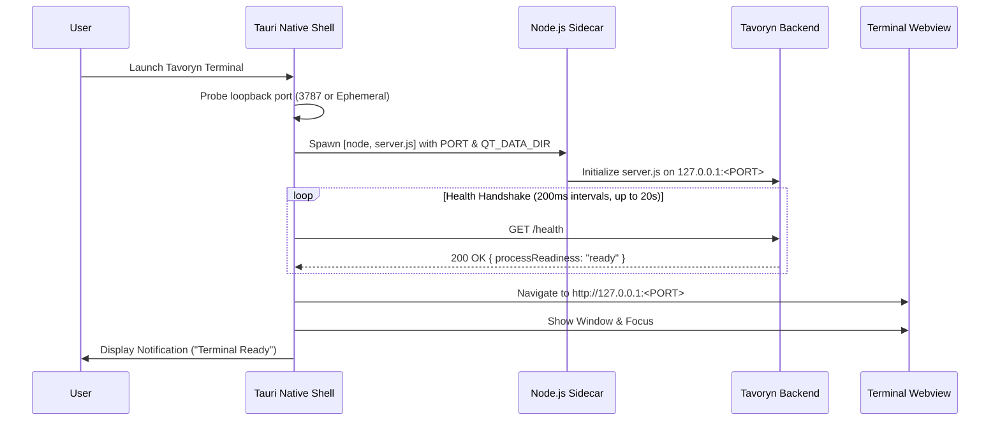
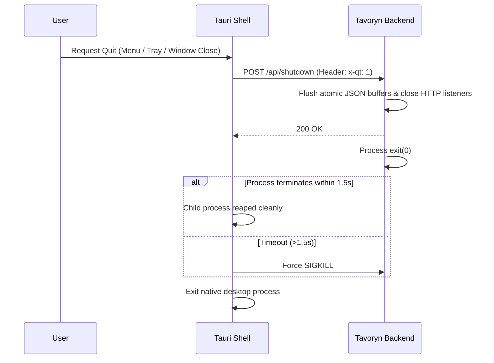

# Tavoryn Terminal Desktop Architecture

**Document Version:** 1.0.0  
**Target Platform:** Tauri 2 Cross-Platform Desktop (Windows 10/11 x64/ARM64, macOS 11+ Intel/Apple Silicon, Linux x64/ARM64)  
**Security Boundary:** Loopback Isolation (`127.0.0.1`), Strict Content Security Policy, Non-Root OS AppData  

---

## 1. High-Level Architectural Diagram

```
+-------------------------------------------------------------------------+
|                        TAVORYN DESKTOP SHELL                            |
|                            (Tauri 2 Native)                             |
|                                                                         |
|  +------------------+  +------------------+  +-----------------------+  |
|  |  Window Manager  |  |   System Tray    |  |  Native Notifications |  |
|  | (Size/Pos State) |  | (Status/Control) |  |   (Alerts/Telemetry)  |  |
|  +------------------+  +------------------+  +-----------------------+  |
|  +------------------+  +------------------+  +-----------------------+  |
|  |   Native Menus   |  | Single Instance  |  |  Safe URL Opener      |  |
|  |  (Shortcuts/Cmd) |  |  Mutex Lock      |  |  (Default OS Browser) |  |
|  +------------------+  +------------------+  +-----------------------+  |
+------------------------------------+------------------------------------+
                                     |
                                     | Spawns & Supervises
                                     v
+-------------------------------------------------------------------------+
|                      BUNDLED NODE.JS SIDECAR RUNTIME                    |
|                         (v20+ LTS Self-Contained)                       |
+------------------------------------+------------------------------------+
                                     |
                                     | Executes
                                     v
+-------------------------------------------------------------------------+
|                        TAVORYN LOCAL BACKEND                            |
|                            (server.js)                                  |
|                                                                         |
|  +-------------------+  +--------------------+  +--------------------+  |
|  | Dynamic Loopback  |  |  Financial Engine  |  |  Market Feeds &    |  |
|  | Port (3787/Auto)  |  |  (DCF, Quant, OOS) |  |  Pipeline Resil.   |  |
|  +-------------------+  +--------------------+  +--------------------+  |
|  +-------------------+  +--------------------+  +--------------------+  |
|  | Paper Trading     |  |  Alerts & Webhooks |  |  Atomic JSON Store |  |
|  | Mutex Broker      |  |  SSE Event Bus     |  |  (OS AppData Dir)  |  |
|  +-------------------+  +--------------------+  +--------------------+  |
+------------------------------------+------------------------------------+
                                     |
                                     | Serves over 127.0.0.1
                                     v
+-------------------------------------------------------------------------+
|                     EXISTING TAVORYN FRONTEND SPA                       |
|                       (Locally Packaged Webview)                        |
|                                                                         |
|  +-------------------+  +--------------------+  +--------------------+  |
|  | Four-Panel Grid   |  |  Lightweight       |  |  CRT Amber / Light |  |
|  | Command Engine    |  |  Canvas Charts     |  |  Daylight Theme    |  |
|  +-------------------+  +--------------------+  +--------------------+  |
+-------------------------------------------------------------------------+
```

---

## 2. Core Architectural Pillars

### 2.1 Native Tauri 2 Desktop Shell
- **Zero Heavy Webview Runtimes:** Reuses the operating system's native modern webview (`WebView2` on Windows, `WKWebView` on macOS, `WebKitGTK` on Linux). The compiled Tauri executable is ~10-48 MB compared to ~250+ MB for Electron.
- **Single-Instance Enforcement:** Utilizes `tauri-plugin-single-instance` via named pipes / OS mutexes to ensure only one instance of the financial terminal runs simultaneously. Secondary launches automatically focus the primary window.
- **Window State Preservation:** Utilizes `tauri-plugin-window-state` to automatically record and restore window dimensions, screen positioning, and maximized status across application restarts.

### 2.2 Bundled Node.js Sidecar Lifecycle
- **Zero Node.js Prerequisite:** End users never need to install Node.js, npm, or Python. A platform-specific Node.js binary is packaged directly into the application distribution.
- **Resolution Strategy:** The Rust sidecar supervisor resolves the sidecar from:
  1. Production bundle resource directory (`<resourceDir>/node-x86_64-pc-windows-msvc.exe` or `<resourceDir>/node`).
  2. Executable adjacent directory (`binaries/node-<triple>`).
  3. Development fallback (`desktop/binaries/`).
- **Process Isolation:** The sidecar process is spawned with loopback-only environment configuration (`HOST=127.0.0.1`), zero standard input (`Stdio::null()`), and redirected output. On Windows, `CREATE_NO_WINDOW (0x08000000)` flag suppresses any detached command prompt windows.
- **Log Management:** Stderr and stdout streams are asynchronously captured and written to `<AppData>/logs/backend.log` with a memory-bounded ring buffer (last 100 entries) available for immediate diagnostic exports.

### 2.3 Dynamic Port Allocation & Startup Handshake
To eliminate port conflicts when port 3787 is occupied by another application:
1. Rust shell tests loopback port 3787 via `TcpListener::bind("127.0.0.1", 3787)`.
2. If occupied, it binds to `127.0.0.1:0` to obtain an available ephemeral port assigned by the OS kernel.
3. The allocated port is supplied to the sidecar via the `PORT` environment variable.
4. The desktop shell displays a native loading state while polling `GET http://127.0.0.1:<PORT>/health`.
5. Once the handshake responds with `200 OK` and `{ "ok": true, "processReadiness": "ready" }`, the main window navigates to `http://127.0.0.1:<PORT>` and becomes visible.



### 2.4 Persistent Application Data Storage
Persistent data is never saved inside `Program Files` or the installation directory:
- **Windows:** `%APPDATA%\Tavoryn\`
- **macOS:** `~/Library/Application Support/Tavoryn/`
- **Linux:** `~/.local/share/tavoryn/` (or `$XDG_DATA_HOME/tavoryn/`)

Directory Hierarchy:
```
Tavoryn/
+-- data/
|   +-- paper-account.json     # Paper trading balance, positions, order state
|   +-- alerts.json            # Active & configured price alerts
|   +-- state.json             # Four-panel layout & workspace tabs
|   +-- demo-requests.json     # Local institutional demo inquiries
|   +-- btst-snapshots/        # Quant strategy execution records
+-- custom/                    # User-defined JavaScript indicators
+-- logs/                      # Rotating backend & diagnostic logs
+-- exports/                   # Exported CSVs and diagnostic bundles
```

### 2.5 Clean Shutdown & Orphan Process Prevention
When the user exits the application (via `File > Quit`, Window Close `[X]`, or Tray Menu `Quit`):
1. Rust triggers the graceful termination sequence.
2. Rust sends an HTTP request: `POST http://127.0.0.1:<PORT>/api/shutdown` with header `x-qt: 1`.
3. `server.js` closes incoming socket connections, flushes any pending filesystem buffers, and exits.
4. Rust awaits exit up to 1500ms; if unresponsive, forcefully terminates (`child.kill()`).
5. Guarantees zero orphaned background processes.



---

## 3. Offline Degradation Hierarchy

Tavoryn Terminal classifies operations into three operational tiers:

| Tier | Capabilities | Offline Behavior |
| :--- | :--- | :--- |
| **Category A: Fully Offline** | Terminal workspace, four panels, user manual, local financial calculations, DCF valuation, stress testing, backtesting on local datasets, paper trading ledger, local state persistence, CSV exports. | 100% operational with zero internet connectivity. |
| **Category B: Online-Dependent** | Real-time market prices, live order book quotes, SEC EDGAR corporate filings, economic calendar updates, options chain feeds, news aggregator. | Fails gracefully; displays offline status banner and timestamp of last successful retrieval. |
| **Category C: Degraded Mode** | Cached historical charts, watchlist quotes, market data pipeline. | Serves cached prices with an explicit "STALE / OFFLINE" marker; prevents stale prices from executing automated stop-losses; polls with exponential backoff. |
